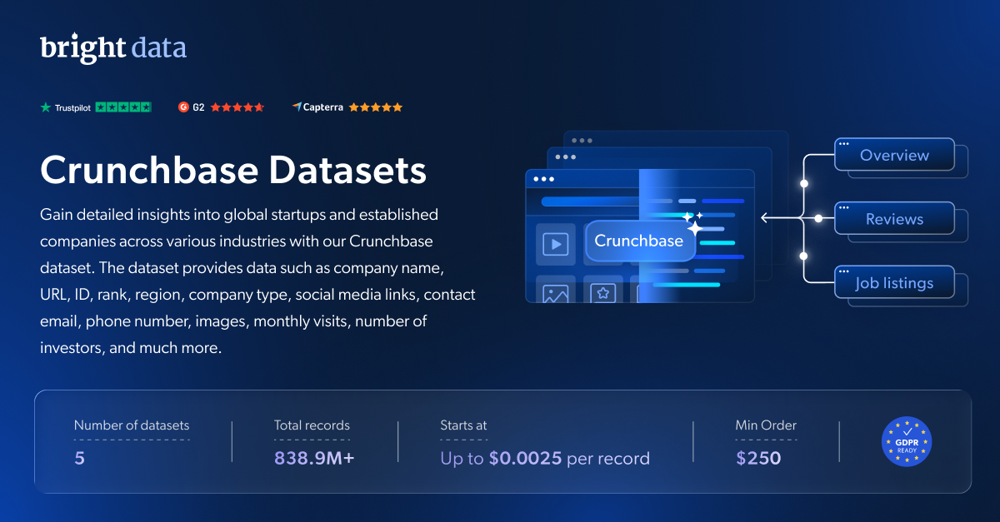

# Crunchbase-dataset-samples

<h2>包含 1001 家 Crunchbase 公司的示例数据集</h2>

<a href="https://www.bright.cn/products/datasets/crunchbase">
   
</a>

包含 1000 多家公司的 Crunchbase 数据集样本。该数据集使用 <b>Bright Data API</b> 提取。

<h2>此免费数据集包含的数据点：</h2>

* ```id```：公司的唯一标识符
* ```name```：公司名称
* ```url```：与公司关联的 URL 或网址
* ```cb_rank```：Crunchbase 为公司分配的排名
* ```region```：公司总部所在的大洲
* ```about```：公司概况或描述
* ```industries```：公司所属行业
* ```operating_status```：公司当前的运营状态
* ```company_type```：公司类型（例如私营、上市）
* ```social_media_links```：与公司关联的社交媒体资料 URL
* ```founded_date```：公司成立日期
* ```num_employees```：公司员工人数

以及更多内容。

这是“Crunchbase 公司信息（公开数据）”数据集的示例子集，该数据集包含超过 <b>3,200,000 家公司</b>。

可用的数据集文件格式：<b>JSON、NDJSON、JSON Lines、CSV 或 Parquet。还可选择将文件压缩为 .gz 格式</b>。

数据集交付方式选项：<b>电子邮件、API 下载、Webhook、Amazon S3、Google Cloud Storage、Google Cloud Pub/Sub、Microsoft Azure、Snowflake、SFTP</b>。

更新频率：<b>单次、每日、每周、每月、每季度或自定义周期</b>。

可在已提取的数据点之外添加数据扩充服务：<b>根据需求提供。</b>

<b>[获取完整的 Crunchbase 公司数据集](https://www.bright.cn/products/datasets/crunchbase)</b>。

<h2>其他可用的 Crunchbase 子集：</h2>

*   Crunchbase 排名最高的公司
*   Crunchbase 规模最大的公司
*   Crunchbase 最新成立的公司

<a href="https://www.bright.cn/products/datasets/crunchbase">
   
</a>

<h2>Crunchbase 数据集有哪些使用场景？</h2>

<h3>1. 竞争分析</h3>

利用公司特征数据监测企业增长、识别关键组织和专业人士、跟踪员工流动，并更高效地增强竞争情报与分析能力。

<h3>2. 市场趋势与增长</h3>

评估公司增长和行业趋势，为数据驱动型决策提供支持。对冲基金、风险投资机构和金融公司可以使用 Crunchbase 数据集显著提升投资分析能力。

<h3>3. B2B 公司数据</h3>

将高质量的公司和员工数据集成到 CRM 中，并借助全面的 Crunchbase 数据集进行扩充，从而增强潜在客户开发和销售情报能力。

<h2>为学术研究人员和 NGO 免费提供网页爬虫工具及数据集</h2>

Bright Initiative 为顶尖高校院系和研究人员，以及致力于推动各类环境与社会公益事业的 NGO 和 NPO 提供 Bright Data 的 <b>[网页爬虫工具 API](https://www.bright.cn/products/web-scraper)</b> 和 <b>[即用型数据集](https://www.bright.cn/products/datasets)</b>。你可以在<b>[此处](https://brightinitiative.com)</b>提交申请。
